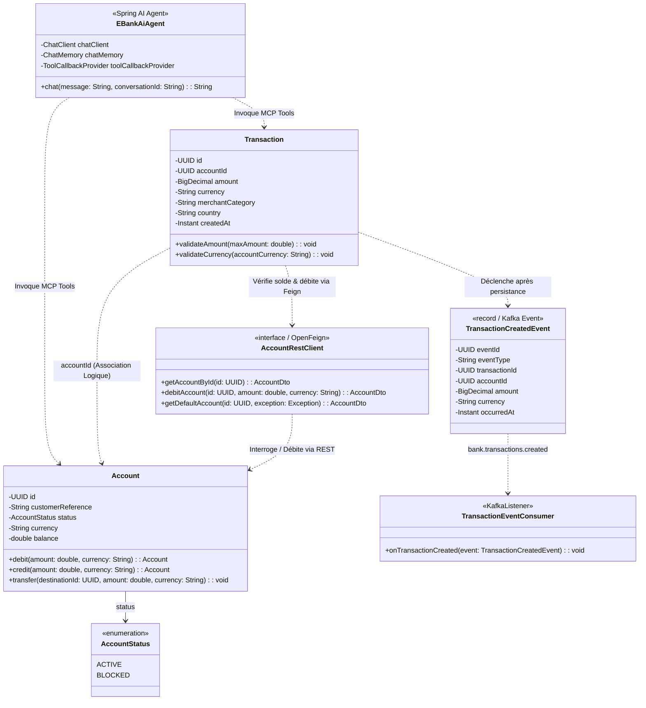

# Diagramme de Classes UML — ADRIA E-Bank

Ce document présente la modélisation UML des entités métier, des clients Feign avec tolérance aux pannes, des événements asynchrones Kafka et de l'agent IA.

## Schéma Mermaid du Diagramme de Classes

## Fichiers Images Générés

- **Image Vectorielle Haute Définition (4770x3270)** : [class_diagram.png](file:///Users/kishyassin/Desktop/cloned_github/test%20adria/diagrams/class_diagram.png)
- **Image Visuelle de Synthèse** : [class_diagram_visual.jpg](file:///Users/kishyassin/Desktop/cloned_github/test%20adria/diagrams/class_diagram_visual.jpg)
- **Script de Régénération** : `diagrams/generate_class_diagram.py`
